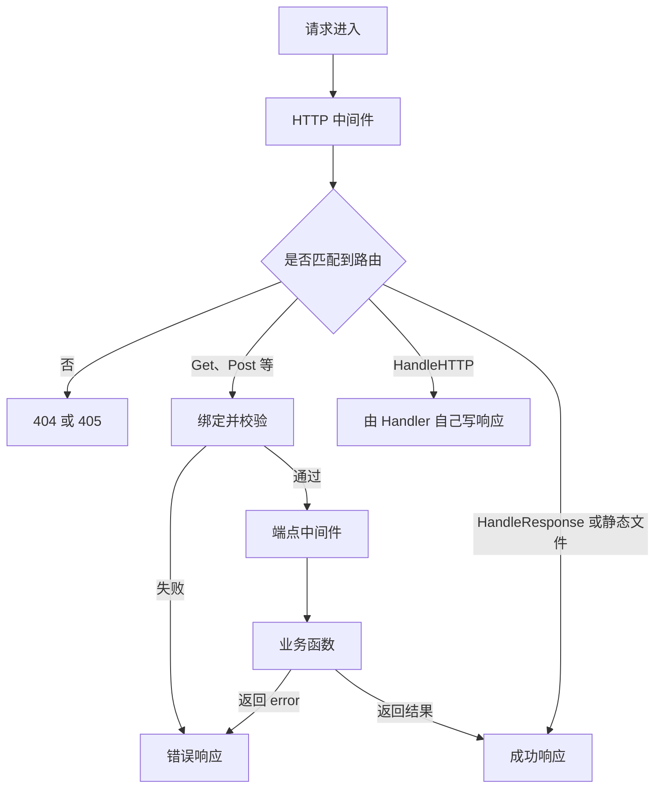

# 请求处理流程

请求进入 `App` 之后，先执行你用 `Use` 注册的 HTTP 中间件，再按注册的路由分发。`Get`、`Post` 这类端点会先绑定并校验请求，通过后才执行端点中间件和业务函数。业务函数返回的值或错误由框架写成 HTTP 响应。

## 中间件

`app.Use` 对所有请求生效，包括静态文件和没有匹配到的路径。先注册的中间件在外层，最先收到请求。

启用 `WithRecovery` 或 `WithPanicMapper` 后，处理过程中的 panic 会变成错误响应。外层中间件在调用结束后可以读到最终状态码。详见 [Panic 恢复](/guide/recovery)。

## 匹配结果

路径没有对应路由时返回 404。路径存在但 HTTP 方法不对时返回 405，并设置 `Allow`。已经注册的 GET 同时接受 HEAD，HEAD 响应没有正文。

这两种响应可以用 `WithNotFound` 和 `WithMethodNotAllowed` 替换，见 [路由注册](/guide/routing)。

## 强类型端点

`Get`、`Post`、`Put`、`Patch`、`Delete` 和 `Handle` 在调用你的函数之前做三件事：

1. 按 `MaxBodyBytes` 限制请求体。默认 32 MiB，超出返回 413。
2. 把正文、查询参数、请求头和路径参数写入一个新的请求对象。字段怎么对应，见 [请求绑定](/guide/binding)。
3. 按 `validate` 标签和 `ValidateRequest` 校验。失败时的响应见 [请求校验](/guide/validation)。

绑定或校验失败时直接返回错误响应，端点中间件和业务函数都不会执行。通过之后，端点中间件按应用、分组、当前路由的顺序执行，然后才是业务函数。

这个请求对象只在当前请求内有效。上传产生的临时文件会在请求结束时清理。

## 写出响应

业务函数返回普通值时，框架用路由上的成功状态码把它编码成 JSON，默认 200。返回 `Response` 时，使用其中的状态码、响应头和正文。返回 `error` 时生成错误响应，不会把 `err.Error()` 直接写给客户端，见 [错误处理](/guide/errors)。

`HandleResponse` 和静态文件不绑定请求结构体，成功或失败的结果仍由框架编码。`HandleHTTP` 由你自己写响应。

如果配置了响应转换器，它只处理强类型端点返回的 JSON，见 [响应转换](/guide/envelope)。
